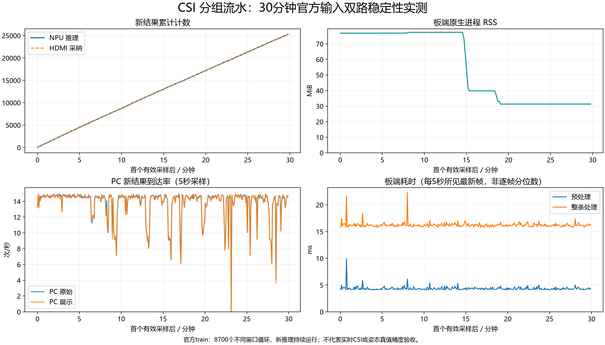

# CSI 分组流水与双路显示：30分钟官方输入长测

2026-10-31授权长测已完成：初始化之后实际运行 **1800.004秒**，原生进程总时长1827.279秒，退出0、SDK／HDMI完整关闭、设备占用为空，PC观察器全部结束。初期和末段均确认双路正常，并确认PC耗时修复后持续变化。本轮有短时间隔波动和一次人工PC展示服务重启，不宣称零卡顿或PC全程零重启。

## 实际结果与证据

| 项目 | 实际结果 |
|---|---|
| 输入／推理 | 25400窗输入，25396次新推理；3次最新窗口替换，计时结束时1窗尚未进入推理 |
| HDMI | 25396次结果采纳，留存监测下溢0；另有118次等待／过期等显示提示 |
| PC原始 | 收到25394帧，与板端成功发送一致；板端发送丢弃2，PC无无效／重复帧，归档丢弃0 |
| PC展示 | 板端成功发送25390、发送丢弃6；重启前快照10493＋重启后14896，合计观察到至少25389帧；末帧身份与原始通道一致，sequence=25396 |
| CSI硬件 | 25396次调用，故障／后端降级0；196807次边界消歧、20次原PS全窗边界回退均保留，不算硬件失败 |
| 分组重叠 | 发布1523760组，其中1100793组读取时PL仍忙 |
| 间隔与记录 | 最长输入间隔2286ms、结果间隔2287ms，之后恢复；板端异步记录丢弃39条 |
| 资源 | 原生RSS峰值79240KiB，稳定阶段由约78712KiB回落至32056KiB；句柄18～19、线程6，未见持续增长 |
| 生命周期 | 一次正常重启、一次SDK，BOOT写入0、SDK重试0；安全退出与设备无占用已核验 |

PC展示计数差1包含停止前快照至实际断开间未计入的可能接收，不能当作精确丢帧数。原展示进程因人工修复结束，退出码4294967295保留；新展示与原始观察进程均正常退出0。累计归档25394帧不等于全部仍在磁盘：有界环实际保留242条完整输出，全时段保留181次板端采样和390次PC采样。

证据：[结构化汇总](../../Deliverables/evidence/longrun/summary.json)、完整板端原生归档（本机留存，仓库未附：`../../.local/csi-longrun-20261031-r1/reports/board-evidence.tar.gz`）、PC分时段记录（本机留存，仓库未附：`../../.local/csi-longrun-20261031-r1/reports/pc/samples.jsonl`）、[现场确认](../../Deliverables/evidence/longrun/visual-confirmations.json)。板端归档SHA256：`6911237f42d0266b6b5b9f62f5b06c8fb02f9a41a87abc9a3cba2e3b57e534dc`。

曲线耗时取每5秒所见最新帧，不是全部推理帧的均值／P95；PC到达率不是浏览器绘制率。RSS回落原因未另行定位，30分钟未见增长不等于任意时长无泄漏；最长输入／结果间隔接近，也不能直接将原因归给FPGA计算。

## 输入与实现

复用合格CSI r3 BOOT（`23922f488d9d4842f217f1b318624c82607e35c6dc0c0b2ea3c803ca4023aa35`），PL幅相90点分组流水与骨架绘制保持，PS相位收尾／投影／多人滤波、原epoch99 NPU及Top3／严格0.2保持。软件只将跨轮累计输入上限由9000扩为36000，单文件仍至多9000窗，并在安全完成回执中记录初始化之后的实际运行时间；固定内存输入缓冲和原安全关闭流程保持。

输入为官方train的30个连续290窗片段，单／双／三人各10段，共8700不同窗口，15Hz单轮约580秒，最多4轮34800窗；原生程序初始化后运行1800秒再正常退出，片段或轮次边界重置跟踪，不重启SDK。播放时间线为生成的演示时间，训练集稳定性不等于独立精度、新实时CSI或全天验收。来源、逐窗名称及实际数据身份见选材记录（本机留存，仓库未附：`../../.local/csi-longrun-20261031-r1/selection.json`）和播放清单（本机留存，仓库未附：`../../.local/csi-longrun-20261031-r1/playlist/dataset.json`）。数据归属与许可沿用[官方数据来源记录](../../software/pose180_pipeline/resident/DATASET-DEMO.md)。

板端每10秒保留状态／资源／CSI累计计数，PC每5秒记录原始和展示通道接收、有效性、更新率、延迟与连接状态，完整输出采用有界环。PC界面自动检查工具因无法识别浏览器URL而停止，实际画面依据现场确认，不能以接收数代替。

关键入口：[准备与PC监测](longrun.py)、[板端只读监测](longrun_monitor.py)。累计上限的C++／Python定向验证已通过，原生线程在初始化前停止与join有效，45000窗／非法轮数／超大文件仍拒绝。证据统一保留于 `.local/csi-longrun-20261031-r1/reports`。

运行中发现PC骨架页耗时空白：raw记录器独占板端原始端口，而view启动时禁用了附加计时连接。已给`resident.mjs`增加本机`--metrics-state-url`共享读取，使用原四元身份匹配且不干预姿态；定向及既有PC回归3项通过。约第12分钟人为重启一次PC view服务，地址39380保持，原始PC接收、板端SDK、HDMI未重启。原view退出码、停止前计数、新进程及“已显示数值并更新”确认单独保留；最终报告须区分这次人工调整和系统自发故障，不能宣称PC展示服务全程零重启。

## 当前状态与恢复

板端包 `/root/pose180-csi-longrun-20261031-r1`，boot_id `737e40ad-de06-4139-b9d0-6fc1ae5ae03d`。本机独立部署包（本机留存，仓库未附：`../../.local/csi-longrun-20261031-r1/pose180-csi-longrun-20261031-r1.tar.gz`）和包身份（本机留存，仓库未附：`../../.local/csi-longrun-20261031-r1/reports/package.json`）保留；PC修复在主机源码中，后续双观察器由`longrun.py pc`统一带入共享计时。当前设备空闲、本批观察进程结束、无自启动；本轮关闭、剩余次数0，再次启动须新记录、正常重启与预检。当前软件／BOOT身份见[default_boot.json](../hdmi_candidate/default_boot.json)，硬件回退仍用保留的r2 CSI BOOT。
