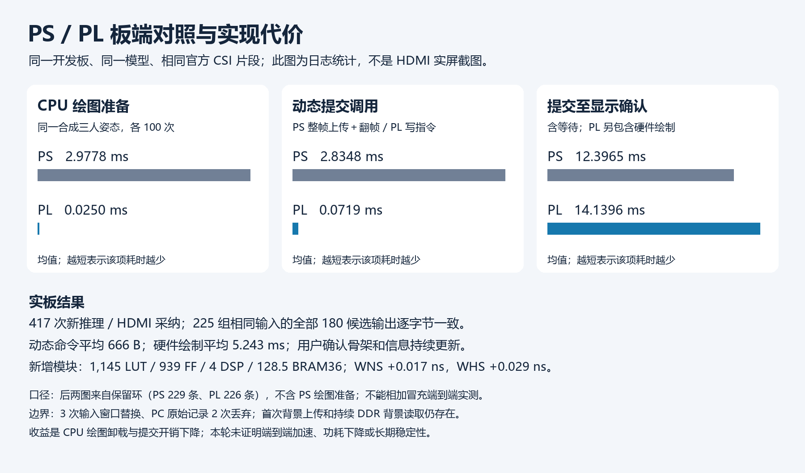
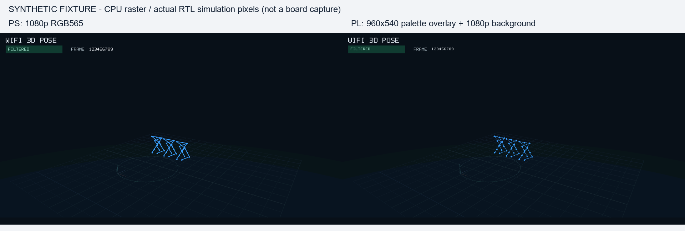
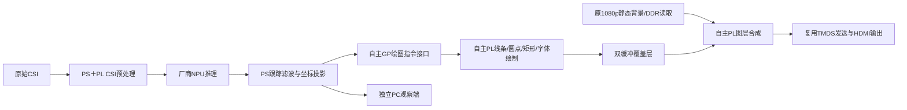

# 骨架硬件绘制与图层合成

**2026-11-01当前状态：** r4源码RAR已在独立新解压目录完成完整综合／链接／放置／物理优化／布线／BIT及Procise适配，配置载荷与包内合格BIT一致；见[完整重建](../../../Deliverables/FPGA-REBUILD-20261101-r1.md)。最新交付为r4 RAR，30段官方输入长测与PC滤波前／后对照已完成有限验证。最后板端观察、默认BOOT及重新启动要求统一见[恢复入口](../../../FPGA/hdmi_candidate/RESUME.md)；下文短测和早期位流身份仅描述各自轮次。

2026-10-31现行交付为r4 RAR；源码含模型权重、最新BIT及目标器件必需IP／网表／实现基线，旧交付包清理，原始实测证据保留。关键数据统一见 [性能与资源汇总](../../../Deliverables/PERFORMANCE.md)，当前入口见 [部署说明](../../../Deliverables/pose180-csi-release-20261031-r4-DEPLOY.md)。以下专项记录保留当时原值。

2026-10-31 阶段恢复后本专项：PS 保留投影，PL 绘制二维骨架、关节点和必要动态信息，以完成整机实现为优先。历史几何／滤波扩展、心率和旧 DATA 调查不恢复。

已完成本专项有限实板验证：算子／像素仿真、ARM64编译、完整物理资格、位流／BOOT封装和真实推理→PL绘图→HDMI均已完成；人工确认骨架及动态信息正常更新。该专项结束时安装overlay BOOT，SDK正常关闭；其后已合并CSI v3，现行BOOT与回退以上方恢复入口为准，旧身份仅作历史。本轮不代表实时CSI复验、长期稳定性或功耗验收。

采用 GP 指令接口、PL Bresenham 画线／圆点／矩形／字体绘制、片上双缓冲覆盖层、帧边界交换。背景复用原 1080p RGB565 DDR 读取；动态覆盖层 960×540、四位调色板、2×显示。PS 做投影与裁剪，不生成覆盖层像素。该取整近似与性能、资源结果一并报告。

本专项物理实现与板测证据目录 `.local/skeleton-overlay-20261031-r2/reports`；r1 保留初版仿真、软件构建和原始失败。r1 实际布局发现原像素 BUFR 区域时钟无法驱动跨区域的完整覆盖层显存（Place 30-764）。r2 将显存两端口均放在既有全局 GP 100MHz 域，用512×4位分布式异步 FIFO 向原148.5MHz像素域送数据，不改频率。原始失败不覆盖。FIFO 下溢时当帧降级为背景，下帧重新同步，并保留粘滞状态。

增量布局的两条布线尝试在1–2处冲突反复循环，停止；14:23核验专属PID后停止，原生退出值4294967295与日志保留，见 `reports/user-cancelled-incremental-routes.json`。含逐网诊断预布线的首轮非增量实现setup失败：WNS=-1.825ns、TNS=-3311.354ns，原始报告／检查点保留。随后复用非增量布局，跳过诊断预布线，直接进行时序驱动布线，将违例降至原HDMI地址递增路径的24ps；布线后局部物理优化消除了最后违例。最终采用 `pipeline-routed-closure.dcp`，未重做综合、改频率或增加豁免。Procise首次因启动环境缺失而初始化失败，按既有封装器环境修复后成功；原始失败 `icap.log` 保留。

证据包括原生命令及日志、仿真结果、实际资源与 setup/hold、最终 bit/BOOT 身份、实板运行及 PS/PL 对照。估算、仿真、综合、布线和实板分别认定；不以日志文案、严格帧率或逐像素外观一致阻断演示。硬件完成、资源释放和时序检查保留。

CSR 基址 `0x400b2000`，ABI `0x534b4c01`。00=ABI，04=busy/error/display_valid，08=暂存字数，0c=暂存tag，10=命令(1提交/2清错/4清暂存)，14=已显示tag，18=绘制周期，1c=已提交字数，20=顺序写指令字，24=显示完成计数。busy 时拒绝修改暂存。每个图元两个字：word0=[color:4,type:4,reserved:4,y0:10,x0:10]，word1=[reserved:12,y1:10,x1:10]；type 1线/2半径2圆点/3含端点矩形/4字形(word1低7位ASCII)。坐标单位为覆盖层像素。最多256图元；零图元表示透明清屏。

## 实板结果与性能对照

唯一结果摘要见 final-summary.json（本机留存，仓库未附：`../../../.local/skeleton-overlay-20261031-r2/reports/final-summary.json`）。候选实际使用1次BOOT安装、1次正常重启、1次SDK，53.186秒正常结束：接收420帧、417次新推理、417次HDMI采纳、PC两路各接收417帧。3次输入窗口替换，PC原始记录端415次落盘／2次丢弃，按演示模式保留原值。原生关闭成功、设备占用为空、PC两个180秒观察器均已结束。在运行期间确认“画面正常，骨架和信息持续更新”，确认记录（本机留存，仓库未附：`../../../.local/skeleton-overlay-20261031-r2/reports/pl-candidate-visual-confirmation.json`）不冒充实屏照片。

保留环中226条PL显示记录的硬件完成计数为192–417，tag全部匹配，粘滞下溢位均为0。板端保留225条完整推理输出，与PS对照按输入内容配对后，225组输入及全部180候选输出逐字节一致。配对按实际输入而非发布序号，避免3次窗口替换造成错配；不将末段225组扩写为420组全程逐位验证。原始证据：板端归档（本机留存，仓库未附：`../../../.local/skeleton-overlay-20261031-r2/reports/pl-candidate-board.tar.gz`）、[PL统计](../../../Deliverables/evidence/overlay/pl-native-display-metrics.json)、[输出对照](../../../Deliverables/evidence/overlay/ps-pl-output-comparison.json)、PC记录（本机留存，仓库未附：`../../../.local/skeleton-overlay-20261031-r2/reports/pl-candidate-pc`）。

| 对比项 | PS绘图 | PL绘图 | 统计口径 |
|---|---:|---:|---|
| 板端CPU绘图／命令准备 | 2.97777 ms | 0.0249792 ms | 同一合成三人姿态，各100次；仅CPU准备，不含硬件绘制 |
| 动态提交调用均值 | 2.83480 ms | 0.07191 ms | 同一420帧片段，两次有限运行；PS整帧写入至翻帧命令，PL写绘图指令；均不含等帧 |
| 提交至显示确认均值／P95 | 12.3965 / 19.5416 ms | 14.1396 / 22.3331 ms | PS229条、PL226条保留环样本；不含CPU准备，PL包含绘制；P95用nearest-rank |
| 每次动态数据负载 | 4,147,200 B | 平均666.37 B，范围112–768 B | 不含CSR地址／总线协议开销；首次静态背景仍上传整帧 |
| PL绘制耗时 | — | 平均524,310.85周期，即5.24311 ms | 硬件计数，100MHz，含清屏 |

本版的实证收益为CPU绘图卸载、提交调用和动态传输量降低；显示确认延迟未降低，未实测功耗，不能宣称NPU或整机端到端加速。背景DDR扫描读取仍存在，不能把指令负载缩小比例当作系统DDR总带宽节省比例。CPU合成基准与实际运行统计也不能相加冒充同一组端到端测量。

最终物理资格：setup WNS=+0.017ns，hold WHS=+0.029ns，TNS/THS=0，94233条可布线网络全部连通，内部未约束端点0；仅保留原批准的两项AI最小周期例外，无新增时序／DRC豁免。新增覆盖层模块1145 LUT、939 FF、4 DSP、128.5 BRAM36等效；整机41297 LUT、55362 FF、28 DSP、234 BRAM36。片上双缓冲占用较多BRAM，这是本实现的主要资源代价。见资格与源码身份（本机留存，仓库未附：`../../../.local/skeleton-overlay-20261031-r2/reports/qualification-closure.json`）及最终原生报告（本机留存，仓库未附：`../../../.local/skeleton-overlay-20261031-r2/reports/physical-final-closure`）。

赛题展示可以说明：自主实现GP指令接口、线／点／矩形／字体硬件算子、双缓冲与跨时钟数据通道、帧边界切换和图层合成，并与PS投影、厂商NPU推理和HDMI发送链路集成；提供了功能仿真、真实上板、接口、资源、时序和软件对照证据。该结果支持“至少完成一项FPGA开发”的要求，最终评审认定仍以赛题完整规则为准。

## 骨架专项当时运行与恢复（历史）

本机包：pose180-skeleton-overlay-20261031-r2.tar.gz（本机留存，仓库未附：`../../../.local/skeleton-overlay-20261031-r2/pose180-skeleton-overlay-20261031-r2.tar.gz`）。已核验上传并部署到 `/root/pose180-skeleton-overlay-20261031-r2`。当前BOOT为 `eae27ceb4ee81440caa1ee9a1d294eb8efd5c72463d228e9f1ee4d70a41c4c22`，boot_id为 `95fb79ae-ba7b-489e-98e2-cd721b0f00cd`；位流、适配位流和压缩包身份见封装记录（本机留存，仓库未附：`../../../.local/skeleton-overlay-20261031-r2/reports/package-review.json`）。包内 `board_tested=false` 是构建时状态，最终实测状态以上述独立结果摘要为准，未为修改标签重打已经实测的包。

本次启动消费已使用，当前无运行负载。再次演示应先在新包目录执行 `sh prepare-boot.sh`，正常重启后 `sh check.sh`，再 `sh start.sh`（默认官方片段、最长120秒、EOF正常结束）。不能在同一FPGA配置下直接重试SDK。PC复用既有 `software/pose180_pipeline/host/resident.mjs`，协议未变。没有新增SDK／推理自启动。

原r3包及 `BOOT-pose-filter-r2.bin` 保留；r3配套原filter BOOT，不能把旧包直接当作当前overlay镜像的启动入口。新包 `boot/BOOT-baseline-filter-v1.bin` 与本机原BOOT身份均为 `a22faaa71cfde653e03898d2d77bd3adee633f3d0b47b710b87c76bf2a22e291`。需要回退时先确认正常关闭及设备独占，再按 `boot_control.py fallback`／`fallback-reboot` 执行有记录的恢复；本次未执行回退。

## 早期与对照证据

先完成独立PS实板对照：包 `pose180-overlay-ps-reference-20261031`，复用原r3软件／模型／420帧官方训练输入，1次正常重启、1次SDK、0次BOOT写入。当时原合格BOOT的boot_id=`6efb69ac-85c0-460a-885f-a4ea698fd695`；420次新推理、420次HDMI采纳、PC两路各接收420帧，native_exit=0，正常关闭、设备占用为空。PS对照本身不代表新PL验证，当前状态见上方。

证据见 PS基准摘要（本机留存，仓库未附：`../../../.local/skeleton-overlay-20261031-r2/reports/ps-reference-summary.json`）、板端原始归档（本机留存，仓库未附：`../../../.local/skeleton-overlay-20261031-r2/reports/ps-reference-board.tar.gz`）、PC记录（本机留存，仓库未附：`../../../.local/skeleton-overlay-20261031-r2/reports/ps-reference-pc`）。保留的229条显示采纳记录平均12.3965ms、P95为19.5416ms（nearest-rank，序号ceil(0.95×N)），口径为整帧上传＋显示采纳等待，不含CPU绘图；原始数据采用有界环，末段228条完整180候选输出经原解码器核验，不能写成完整保留420条原始记录。PC接收420帧的事实由独立计数证明。

| 事实 | 原始证据 | 限制 |
|---|---|---|
| 算子、覆盖顺序、忙时保护、坐标边界、帧切换、缩放与背景合成通过 | 像素仿真日志（本机留存，仓库未附：`../../../.local/skeleton-overlay-20261031-r2/reports/sim-120956/simulate.log`） | 缩小光栅的确定性仿真，不是实板 |
| 三人指令在完整960×540覆盖层绘制，524866周期 | 完整帧仿真日志（本机留存，仓库未附：`../../../.local/skeleton-overlay-20261031-r2/reports/frame-121119/simulate.log`） | 合成姿态；100MHz换算5.24866ms，包括清屏，未计GP提交和帧等待 |
| 初版模块997 LUT、707 FF、6 DSP、128.5 BRAM36等效 | 模块资源报告（本机留存，仓库未附：`../../../.local/skeleton-overlay-20261031-r1/reports/ooc-114340/utilization.rpt`） | OOC综合，不能替代整机布线资源与时序 |
| PS投影／原始姿态保持，0/1/3人指令176/368/816字节 | 软件测试（本机留存，仓库未附：`../../../.local/skeleton-overlay-20261031-r1/software/overlay_tests.log`） | 合成样例；日志中的CPU时间来自本机容器，不能当作板端基准 |
| 同一板端三人样例：PS整帧准备2.97777ms，PL指令准备0.0249792ms（816字节） | [板端CPU基准原始日志](../../../Deliverables/evidence/overlay/board/ps-benchmark-121333.log) | 合成姿态、各100次；未启SDK，不含GP提交、PL绘制和帧等待，不是端到端加速比 |
| ARM64主程序与原显示／资源释放回归通过 | 编译日志（本机留存，仓库未附：`../../../.local/skeleton-overlay-20261031-r1/software/arm-build.log`）、释放测试（本机留存，仓库未附：`../../../.local/skeleton-overlay-20261031-r1/software/hdmi_resource_tests.log`） | 资源测试为SDK替身，不冒充硬件停止证明 |
| 独立包复用原模型与420帧官方输入，启动参数核验通过 | 包检查（本机留存，仓库未附：`../../../.local/skeleton-overlay-20261031-r2/reports/software-package-check.json`） | BOOT资格完成前不可启动，未新启SDK |

原图和来源见 图像目录（本机留存，仓库未附：`../../../.local/skeleton-overlay-20261031-r2/reports/figures`）。命令字节数不包括CSR地址／协议开销；首次背景仍提交完整4.1472MB，HDMI持续读取背景的带宽也仍存在。当前不宣称板端端到端加速或功耗下降。

## 分工与复用

新增自主开发为 `overlay.sv`、`palette_fifo.sv`、GP路由接入、握手与合成、PS命令生成和提交。字体数据复用项目原 `font5x7.hpp`；投影、背景、帧读取、停止排空和启动消费复用项目既有实现。厂商PS/AI/DDR/IP与HDMI时钟/TMDS链路保持，未把厂商模块计作新增自研。

## 复现

`run.py sim/frame/ooc` 保留每次实际日志与退出码；`build_software.py` 编译软件；`prepare.py` 创建隔离整机输入。整机用工作目录 `run_stage.py` 顺序执行 synthesis、opt（本轮约束调用修正后由 opt-linked 从现有检查点续接）、place、route、report；实际物理资格通过后才生成 bit、执行原厂ICAP处理和BOOT封装。原 opt 失败日志保留，未重跑已完成综合或IP链接。

`package.py software` 准备候选软件；`package.py boot` 仅在物理资格通过且原生bit已生成后封装。不会自动写板或安装自启动。已执行的板端结果见上方。

实际通过链为工作目录 `run_stage.py` 执行 `place-nonincremental` → `route-direct` → `physopt-direct` → `report-closure`，再由 `qualify_closure.py` 核验、`bit-closure`生成位流、`package.py boot --implementation closure`封装。每步Tcl／原生日志、资格报告和检查点均保留在工作目录，封装记录绑定 `pipeline-routed-closure.dcp`；此前不合格分支不生成位流、不部署。`prepare.py`保留初始输入生成过程，不能把最初增量策略误称为最终合格策略。

`summarize_board.py RUN_DIR OUTPUT_JSON` 汇总原生显示事件；`compare_outputs.mjs` 使用原解码器按实际输入配对完整输出；`render_benchmark.py` 从日志统计生成可用于文档的PNG图。均保留实际样本数与证据范围。
