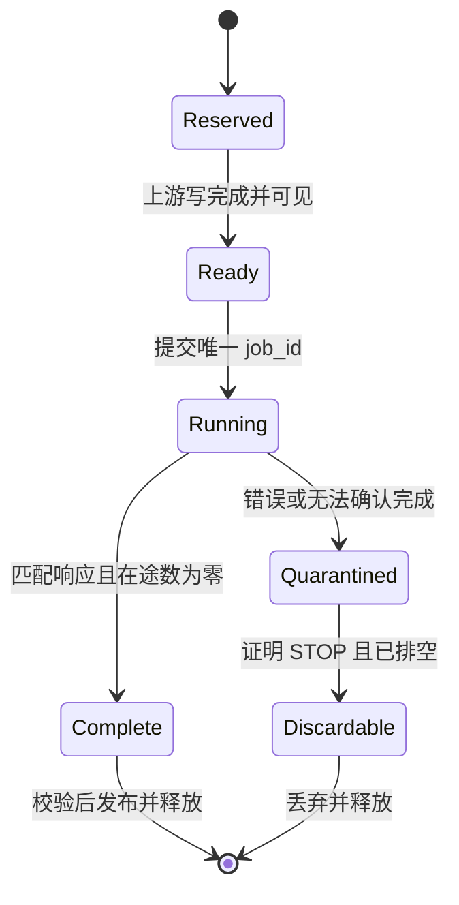

# 旧 100-query 模型的 TopK／Gather 融合实验

2026-11-13。已完成独立 PL 小形状／通用任务外设、C++ 调度／生命周期接口、旧模型分段适配和公共 SDK mock 绑定验证。路线一的原生 FP16／C16 兼容模式进一步删除 36 个格式转换 HardOp，完成原模型指令＋PL 的整图数值对照；路线二也完成原模型三段与排名候选二进制的串接验证。两条路线的实际模拟输出均与原 NPU 图／CPU 数学参考逐位一致，当前整图输入为一份确定性合成数据。**现有 NPU 候选已通过 7 组实板首次输出逐位比较，真实 PL DDR 搬运及直接端口绑定通过；PL 核的 SoC 接入、整机 BIT／BOOT 和整图实板验证尚未完成，也没有端到端提速结论。** 原 epoch99／180-query 交付模型未修改。路线一是在 FPGA 可编程逻辑中增加硬件，路线二才是直接复用现有 NPU 指令。

## 范围与复用契约

目标为 `model/piw24_shared-20261015-r1` 中的两条内部链路：

| 链路 | 分数／索引 | 特征 Gather |
|---|---|---|
| A | Add 174 → TopK 188，180→100 | GatherElements 192，42 个有效通道 |
| B | Sigmoid 435 → TopK 437，100→100 | Gather 442，42 个有效通道 |

100→50 是复用验收用例，不是修改原模型输出。排序为分数降序，同分时原始索引较小者优先，与 [ONNX TopK 同分规则](https://onnx.ai/onnx/operators/onnx__TopK.html)一致。

原 `piw24_shared_ZG.json` 的 TopK 188／437、GatherElements 192、Gather 442 实际标为 `@hostt`，周围存在 NPU／Host Cast。该编译图的索引存储为 FP32；新 PL 内部记录／输出采用 uint64，不能直接以相同字节地址替换。当前分段适配已确认两处索引仅供各自 Gather 使用，将索引边界消除；其它存在外部索引消费者的图仍须明确转换。模型整体使用 NPU 不等于这些算子已在 NPU 执行。

逻辑接口为分数 `[B,N]`、特征 `[B,N,C]`，输出 `[B,K]` 和 `[B,K,C]`。其它形状须明确候选轴，再将独立行、特征维归并到 B／C；不自动推断轴语义。

- PL：同一 RTL 接受运行时 N／K；单块排序容量 256，较大 N／K 由分块与归并实现。分数读取支持连续 C1 的 FP16／FP32；默认 FP16 精确展开为 FP32，Gather 逐位复制。显式兼容变体按旧模型已测转换语义将 FP16 指数为零的输入归为正零。两种模式均支持有限分数、64 位全局索引、规范 dense／C16 布局及通道尾部补零。
- 当前 NPU 候选：一份产物固定容量 Nmax=180、Kmax=100、C=42，通过运行时掩码选择 `1≤K≤N≤180，K≤100`。物理输出容量不变，有效前缀外索引为 -1、数值为 0。这不是无限动态形状二进制。
- PL 默认预算为 64 MiB 记录暂存、100 万个任务；Gather 还受 32 位 DDR 地址窗口、实际分配大小和对齐限制。空 B／K 返回空任务，非法形状／越界拒绝执行。任意步长、任意数据类型和无限尺寸不在已验证范围内。
- NPU 精确排名要求分数来自有限 FP16 并提升到 FP32。数值测试中的特征也采用 FP16 可表示值，不能推广为任意 FP32 精度保证。

## 路线一：PL 分块排序和一次 Gather

`host/topk_plan.hpp` 是 SDK 无关入口，`make_plan()` 产生块排序、二路归并和最后一次 Gather 的任务图。每块保留 `min(K,块长)`，归并保留前 K 并排空两路输入。若候选在本块已排到 K 名之后，至少有 K 个本块候选优于它，因此它不可能进入全局前 K。该性质也适用于 K 大于 256。

排序／归并只移动“分数＋索引”记录。特征保持原位，获胜索引确定后才复制一次，避免重复搬动整行特征。`bind_scratch()` 将计划绑定到调用者已拥有的两片 DDR 分配；它不调用 SDK 分配内存。

每条暂存记录为 16 字节：FP32 分数字位、4 字节零填充、uint64 索引。每个叶块独占完整 64 字节行，预算包含各块尾部填充。缓冲区从最终归并根节点反向交替分配：每对输入在同一片，输出在另一片。这样即使某层有奇数个块，落单块也不需要额外复制。地址绑定检查整个分配的边界和别名；调用者还须保证两片暂存与分数、特征和最终输出分配互不重叠。多批次仅在上一批实际完成且排空后复用。

| 文件 | 职责 |
|---|---|
| `rtl/topk_order_pkg.sv` | 有限 FP32 位序比较；正负零同分，索引决定同分先后 |
| `rtl/topk_tile.sv` | 256 项以内的串行插入式 TopK；运行时 N／K，输出保留原始分数字位 |
| `rtl/topk_merge.sv` | 两个有序流裁剪归并；DONE 前排空，尾部非有限值也令任务失败 |
| `rtl/score_reader.sv` | 64 字节分数读取、精确 FP16 展开、分配边界与读错误检查 |
| `rtl/score_topk.sv` | 分数读取与块排序连接；读错误后中止本地排序并等待排空 |
| `rtl/run_reader.sv`／`rtl/run_writer.sv` | 16 字节记录的整行读取／掩码写回；校验保留字、索引、有限分数，排空已呈现请求 |
| `rtl/line_read_arbiter.sv` | 两个记录读取器共享 DDR；锁定请求归属到响应接收 |
| `rtl/memory_tile.sv`／`rtl/memory_merge.sv` | 分块选取／归并的完整内存任务；读排空与带标签写完成共同决定 DONE |
| `rtl/memory_stage.sv` | 两类任务复用一个内存端口；START 锁定引擎选择，busy 拒绝再次启动 |
| `rtl/command_kernel.sv` | ABI 2.0 命令执行；分块、归并和最终 Gather 共享内存接口与完成记录 |
| `rtl/gather_engine.sv` | 索引读取、布局变换、字节使能、边界检查和带标签完成握手 |
| `rtl/topk_gather_tile.sv` | 默认 N≤256 的融合通路；参数模式读取最终有序记录，复用 Gather／分发／整体完成 |
| `rtl/record_writer.sv` | 选中分数 FP32／索引 uint64 写回；字节使能保护尾部，中止不撤回在途写 |
| `rtl/topk_gather_kernel.sv` | 完整内存输入／输出接口；三路输出共同 fence、写仲裁、分配别名拒绝 |
| `rtl/kernel_control.sv` | AXI-Lite 任务寄存器；运行参数锁定、单任务、唯一身份、保留完成响应 |
| `rtl/topk_gather_device.sv` | 单时钟 AXI 外设；默认小形状直通，`GENERIC_SHAPES=1` 为统一任务版本 |
| `rtl/write_coalescer.sv` | 可选四行写合并；排空脏行后等待下游完成响应 |
| `rtl/axi_line_port.sv` | 64 字节 AXI4 单拍事务；真实 RLAST／B 响应驱动完成判断 |
| `host/topk_plan.cpp` | 有界计划、描述符检查、资源生命周期守卫 |
| `host/topk_scratch.cpp` | 两片物理暂存的区间与归并树绑定 |
| `host/topk_registers.hpp` | 将已验证的描述符打包为 ABI 1.0／2.0 寄存器镜像 |

排序数组使用无复位数据 RAM，只复位有效状态；片内保存局部索引偏移，输出时加 64 位基址。首版将整个数组写成带异步复位的寄存器，消耗 20,845 LUT；当前含本地中止处理的版本为 1,012 LUT。算法仍为串行插入，最坏比较／移动量 O(NK)，资源下降不等于吞吐提升。

分数读取器将参数锁存与分配检查分成两拍，避免外层地址别名、形状检查与本地容量算术串成过长路径。完整外设 OOC 估算 WNS 从 0.461 ns 提升至 2.951 ns，增加 36 个寄存器；启动增加一拍，不改变输出语义。该结果不代表实际整机频率或推理延迟已通过。

融合核先读入分数并排序，再将每个获胜记录分别交给 Gather 和分数／索引消费者。两路独立握手，共享 DDR 读端口会锁定请求地址与归属，直到响应被原请求模块接收。`topk_gather_kernel` 已接入分数／索引写回；三路输出全部停止写入后才发出一次共同 fence。原流式 `topk_gather_tile` 仍可单独复用，此时记录流在整体成功 DONE 前都是暂存结果，消费者必须继续排空错误任务的记录，不能提前发布。

`make_kernel_descriptor()` 检查单批 N≤256、FP16／FP32 分数、特征布局、分配大小／对齐／地址窗口，并拒绝任意输出分配与其它输入／输出重叠。选中分数输出固定 FP32，索引固定 uint64，特征保留原 FP16／FP32 位模式。B>1 由上层逐批提交。

大形状的 `memory_stage` 接收分块／归并命令，使用同一端口读取原始分数或两路记录、写出新记录并等待可见性确认。C++ 计划已驱动该 RTL 执行 6 组形状×2 批次，最大 1025→1025；任务中改变外部操作选择、重复拉高 START 均不改变已接受任务。最终阶段将 `topk_gather_kernel` 的静态参数 `INPUT_IS_SORTED_RUN` 设为 1：`score_base/score_bytes` 改为已完成的 K 条记录分配，`input_count` 仍为原 N，供索引边界检查使用。此模式没有 256 项排序限制；`make_run_gather_descriptor()` 校验其独立描述符。它不能提交到现有 ABI 1.0 的小形状外设。

`command_kernel` 已将分块／归并与最终 Gather 接到同一设备命令入口。通用外设测试直接保留实际中间内存，CPU 只写控制寄存器，不将参考记录灌回 DUT；同一 RTL 实例无需重编译即执行 180→100、100→50、513→400、1025→513、1025→1025。仍缺实际 SoC 连接和 SDK 驱动；仿真中的存储模型与 fence 不能替代平台完成语义。

### 独立外设控制接口

`topk_gather_device` 将完整核接到 AXI 读／写响应适配器，并提供 256 字节的本地 AXI-Lite 寄存器窗口。它不指定 SoC 基址，也未接入原厂互连或 SDK；CSR 与内存端口目前使用同一时钟。

| 本地偏移 | 含义 |
|---|---|
| `0x00`／`0x04` | 只读标识 `0x544b4731`／ABI `0x00010000` |
| `0x08` | 状态位 0 idle、1 busy、2 completion；位 11:8 为错误码 |
| `0x0c` | 完整 32 位写：1 提交、2 确认已读取的完成记录 |
| `0x10`／`0x14` | 完成任务编号低／高 32 位 |
| `0x18`／`0x1c` | 任务周期低／高 32 位；完成后保持稳定 |
| `0x20`／`0x24` | 完成任务的读／写事务数 |
| `0x28` | 单块容量 256 |
| `0x2c` | FP16 策略：0 保留位语义，1 将指数为零的 FP16 归为正零 |
| `0x40..0x94` | 22 个描述符字；字段顺序见 `make_register_image()` |

只在 idle 写入描述符；提交后到确认完成前，修改参数和再次提交返回 SLVERR。任务编号非零且在本次复位会话内严格递增，确认后也不能重复使用。AXI-Lite 的 AW／W 分别接收，B／R 响应保持到握手；描述符支持字节使能，命令要求完整字写入。完成 IRQ 保持到软件确认。错误码 9 表示内部完成编号不符。

寄存器完成状态来自三路写回及真实 AXI B／R 排空，不来自 START 写成功。提交前的 NPU 生产完成、分配所有权及缓存可见性仍由平台层证明。该版本没有软件强制复位／取消寄存器；无响应任务必须保留资源并由平台提供 STOP／排空证明，不能通过写 ACK 或局部复位绕过。64 位周期值只在完成后读取作为稳定快照。

`GENERIC_SHAPES=1` 使用 ABI `0x00020000`，复用同一控制状态／唯一编号／AXI 完成机制；魔数仍标识同一外设族，软件须同时检查 ABI。描述符扩展为 32 字，窗口结束于 `0xbc`。原 22 字中，N／分数分配在记录命令下表示左输入数量／分配，目标特征分配表示记录输出；最终 Gather 时恢复原字段语义。

| 追加偏移／字号 | ABI 2.0 含义 |
|---|---|
| `0x98`／22 | 操作：0 分数块排序，1 两路记录归并，2 最终记录 Gather |
| `0x9c..0xa4`／23..25 | 归并右输入地址、分配字节数、记录数 |
| `0xa8..0xac`／26..27 | 分块全局索引起点，低／高 32 位 |
| `0xb0..0xb4`／28..29 | 归并索引上限，低／高 32 位 |
| `0xb8..0xbc`／30..31 | 保留，必须为 0 |

每条命令必须等到匹配完成后再提交依赖它的命令。失败的分块／归并结果不得交给后继；通用外设测试包含一次读失败，等待失败任务真正排空后重新执行该块，再继续全图。它没有设备内自动执行队列，CPU 仍负责 C++ 计划的有序提交。分数块必须保持 64 字节对齐：默认 256 项块同时满足 FP16／FP32；选择其它规划块长时，调用者须满足实际分配／起点约束，不能将仅算法层可行的计划直接当作 DMA 描述符。

两种外设是静态配置选择。ABI 2.0 的同一硬件覆盖多种合法形状，但小形状也要经过记录暂存；ABI 1.0 保留直接融合路径作比较。选择通用性并不消除额外读写和多次提交成本，最终仍按端到端板测选择。

`FP16_FLUSH_TO_POSITIVE_ZERO=1` 是独立、显式的兼容配置：ABI 分别变为 `0x00010001`／`0x00020001`，策略寄存器为 1。软件在 START 前须用 `validate_register_contract()` 核对实际标识、ABI、策略和本次任务要求；默认配置仍为 1.0／2.0、策略 0。兼容规则只作用于原始 FP16 分数和逻辑 FP16 特征，不作用于 FP32、uint64 索引或 16 字节记录；归并阶段保持已转换的 FP32 位模式。

### 搬运与数据完整性

优先方案是 NPU 与 PL 使用受 SDK 管理、生命周期固定的 PL DDR 分配。CPU 提交描述符和控制状态，特征不作完整 Host 往返。SDK 用户输出绑定必须在 apply 前建立，且编译器不能提前复用分配。**设备集成尚未实现，不能称为已实现零拷贝。**

公共接口已核实：Icraft 3.39 的 `ZG330Backend::userConnectNetwork(MemChunk&, value_id)` 支持部署前绑定网络输入／输出；[厂商说明](<C:/Icraft/CLI v3.39.0/docs/zg330backend/index.html#userconnectnetwork>)要求起点按 4096 字节对齐。`probe_sdk_binding.py` 仅打开字面量 `mock://zg330`，经 `Session.CreateWithBackends()`／`apply()` 检查所有边界的公开 `ValueInfo`／`MemChunkInfo`，并构造直接引用这些分配的 Tensor。全部 13 次端口绑定落到指定地址、标记用户所有、无 staged chunk；同一跨段值始终共享一份分配。

保留 FP32 边界时，11 份模型边界分配为 235,072 字节；原生布局模式为 198,656 字节，减少 36,416 字节。两种模式另有三份 PL 私有分数／索引分配，共 2,112 字节。mock 管理器部署峰值分别为 36,923,420／36,610,180 字节，包含后端分配；这不是实板占用结论。两种模式的 13 次端口绑定均直接落到指定分配，清理后管理器计数回到 0。无 NPU forward 调用，不能由这项回收测试推定运行中可安全释放。

布局须来自真实图。例如链路 A 的 NPU 特征是 `[1,3,180,16]`、42 个有效通道，不是连续 `[180,42]`。C16 地址为：

`base + (channel/16)*N*16*element_bytes + index*16*element_bytes + (channel%16)*element_bytes`

源／目标完整分配必须不重叠、按 64 字节对齐，并拥有最后一行全部字节。读限制在分配内，写用字节使能保护邻接数据。非法索引、地址越界、读错误和完成错误使任务失败，错误结果不发布。



`JobGuard` 约束状态转移，不产生硬件完成证明。超时、ready、layer_count、缓存刷新和进程退出都不是释放许可。排序核检查分数有限性；位复制 Gather 不解释特征数值，最终消费者仍须执行项目的有限数值／身份发布检查。

AXI 适配器使用固定 ID、非缓冲事务属性，写数据接收后继续等待 B，读等待本 ID 的 RLAST。错误 ID 不结束本事务。写合并缓冲全部排空后才向下游提交 fence。设计依据 [Arm AXI 非缓冲写完成要求](https://documentation-service.arm.com/static/64256e84314e245d086bc88f)，实际互连仍须完整传递属性和响应；这不代替 CPU 缓存所有权转换，也不解决上游 NPU 完成边界。

原厂 `User_Ddr` 未暴露写响应，**不能把它的 ready 接成 B 响应**。新适配器须接到真实 AXI 响应通道，并检查地址域、跨时钟、所有权和停止流程。这些整机接入工作尚未完成。

### 旧模型的分段适配与联合仿真

`model_partition.py` 根据真实依赖划分三段，保留原指令／权重，只在实验目录导出副本。`export_model_partition.py` 同时通过公共 Tensor 读回 RAW 中的两个 K 参数，确认均为 100。适配器的 14 项单元测试覆盖候选轴、降序／排序、边界形状／布局、输出身份、私有索引／格式中间值使用、原生量化及执行顺序。原生模式另核对已测原 JSON／RAW 身份，不能对其它图自动假设转换语义。

| 阶段 | 输入 Value | 输出 Value | 原 HardOp 数 |
|---|---|---|---:|
| NPU 0 | 0 | 440、3443 分数、3451 特征 | 370 |
| PL A | 3443、3451 | 495 特征；私有分数／索引 | — |
| NPU 1 | 440、495 | 3467 分数、3471 特征 | 417 |
| PL B | 3467、3471 | 1136 分数、1148 特征；私有索引 | — |
| NPU 2 | 440、1136、1148 | 原输出 3483、3487 | 220 |

Value 440 跨越两处融合，分配一直保留到最后一段完成。A 的选中分数 485 无消费者；B 的选中分数 1136 必须保留。A 的 14 个索引展开 HardOp 与四个 Host TopK／Gather 一起被替换，保留 1,007 个原 HardOp。默认 SDK 连贯执行优化在 mock apply 后形成 2、2、1 个会话操作组，不能把这个计数当作硬件完成证明或实测加速比。

默认适配保留上述 dense FP32 边界。原生模式使用 A 的 448／478 输入、7470 输出，以及 B 的 1133／1145 输入、8747 特征和原 1136 分数输出。A 为 C16→C16，B 为 C16→dense，特征均是 FP16；选中分数仍是 FP32。保留三段 HardOp 分别为 358／401／212，共 971；在原有 14 个索引展开和四个 Host 算子之外，再删除 36 个格式转换 HardOp。统一核仍写出私有分数／索引，后续可在保持排空契约的前提下裁掉不被图消费的写回。

`probe_native_layout.py` 的直接原位复制假设首先失败：原指令模拟器把 FP16 非规格化数和负零变为正零。按显式兼容规则重测，16 组输入×两处转换链覆盖全部 63,488 个有限 FP16 特征位模式，前后转换逐位通过，C16 填充 NaN 未进入有效通道；分数链测试了边界值及多组有限模式。厂商 `include/icraft-utils/numeric.h` 的 `emxxToFp32` 也明确区分正常非规格化转换与 RTL 对齐模式，但真实板端行为尚未验证。

RTL 的默认及兼容分数读取器分别通过全部 65,536 个 FP16 位模式；兼容完整外设通过 16 个连续任务、全部有限特征位模式及两种目标布局。通用兼容外设在同一实例执行 5 组形状、31 条命令，覆盖 FP16／FP32 分数、归并记录、错误排空和最终 Gather。原直接复制失败保留于 `native/native-formats-r1`，未改写为通过。

`validate_model_flow.py` 用一份确定性合成输入完成 NPU 0 → PL A → NPU 1 → PL B → NPU 2。NPU 使用原厂 Host 指令模拟器，PL 使用完整 AXI-Lite／AXI 外设；只有逐位比较通过的实际 DUT 输出才送入下一段，参考结果不回填数据通路。另执行原 14 个索引展开 HardOp，确认每个选中索引确实广播到 42 个通道。最终 100 个分数与 4,200 个特征均有限。

后续 `validate_model_reference.py` 执行包含全部 1,021 个原 HardOp 的单一参考图，以独立 CPU 数值排序／字节 Gather 提供原 Host 边界输入。参考图重新计算的 5 个边界张量及两个最终输出，与联合仿真全部逐位一致；边界回查保证参考输入与原 NPU 计算一致。这是原 NPU 指令＋独立 CPU 数学参考的整图对照，未执行原 HostBackend 的自定义注册实现，也不是实板精度或真实 CSI 数据集验收。

第二次联合验证直接采用 mock SDK 的实际分配地址，经 C++ 描述符校验后驱动 RTL。改变分配地址前后，两个融合点的全部输出和最终模型输出均逐位相同；完整分配尾部与仿真保护区通过。测试为不同模拟器间的文件串接，尚未验证真实共享总线、NPU 完成可见性或板端性能。工具使用 HQB 导出原始布局／存储；SFB 会将量化 FP16 展开为 FP32，不能直接作为后继原始存储输入。

原生布局联合验证同样使用公共 mock 分配地址，并执行全部 1,021 个原 HardOp 的参考图对照。100 个最终分数、4,200 个姿态值均逐位一致；兼容规则通过并不扩大到非有限输入或任意量化类型。

### 避免搬运拖慢推理

1. 只有分数／索引参与排序归并，特征 Gather 一次；常驻资源复用，避免逐帧分配、映射、编译。
2. 保持 NPU 物理布局，只有消费者需要时才转换；评分张量的 Host 往返也应消除。
3. 四行合并使 42 通道 C16/FP16 的 180→100 外部写从 300 降到 150 次，100→50 从 150 降到 75 次。但当前低延迟内存仿真总周期略增，因此保持可选，不能由带宽下降推断提速。
4. 板测比较“提交＋等待＋评分读取＋排序归并＋Gather＋可见性同步＋后继启动”的整段时间，包含所有搬运／缓存成本。真实输入比较通过且总延迟改善后才替换原路径。Windows 模拟器时间不是 NPU 时间。

三路内存输出独立核的 C16→C16、FP16、42 通道用例结果如下。周期来自固定种子的背压／延迟内存模型，包含分数读取、分数／索引写回和最终 fence；不包含设备提交或后继 NPU，不能换算为实板提速。四行缓冲还要容纳分数／索引写入，外部事务数不再恰好等于单独 Gather 的减半值。

| N→K | 不合并写：周期／外部写次数 | 四行合并：周期／外部写次数 |
|---|---:|---:|
| 180→100 | 15,331／320 | 15,930／171 |
| 100→50 | 6,530／161 | 6,813／86 |
| 100→100 | 12,944／320 | 13,468／172 |

原模型实际模拟中间值的两种边界，对同一版本外设测试平台、相同输入及相同延迟种子重测如下。选中分数／索引和最终模型输出逐位一致；统计只包含 PL 任务，不包含删去的 36 个 NPU 格式算子或真实提交／同步成本。

| 融合点 | FP32 dense：周期／读／写 | 原生 FP16：周期／读／写 |
|---|---:|---:|
| A，180→100 | 16,977／362／283 | 16,841／306／320 |
| B，100→100 | 13,070／351／283 | 11,899／304／152 |

A 的 C16 输出每行 32 字节，当前逐行写会产生半行事务，因此写次数反而增加。两处合计周期下降约 4.35%，只能描述该模拟内存条件；原生布局不保证实板更快。保留原生／dense 对照、可选写合并和整段计时是必要的选择依据。证据为 `native/native-transfer-comparison-r1`，默认对照重新运行于 `native/model-flow-r6`。

## 路线二：现有 ZG330 指令

`tools/topk_fusion/build_native.py` 用公共 XIR 算子构造稳定排名：

`rank(i) = count(score(j)>score(i)) + count(score(j)==score(i) and j<i)`

不同有限 FP16 值至少相差 2^-24。计算 `d=2^24*(score(j)-score(i))` 并裁剪到 `[0,1]`，可在限定数域内得到精确“大于”判定。同分项由索引补足，每个有效候选得到唯一排名。根据排名构造 0／1 矩阵 M，用 `M×index`、`M×score`、`M×payload` 生成结果。

N／K 用运行时掩码输入，无需重编译。无效候选先扣除 262144，落到所有合法 FP16 分数之后。扣除量先由掩码计算，避免对合法微小数先加大常量再相减而损失精度。此优化删除大矩阵上的两次屏蔽：当前为 **54 个 HardOp、75,392 字节指令**，优化前为 61 个、79,616 字节。它仍是 NPU 子图，不是已经发布的单条排序指令或单个融合 HardOp。

O(N²) 比较和中间张量使其未必快。当前图逐个 HardOp 累加输入约 2,978,688 字节、输出约 2,455,440 字节；这是端口张量体积，**不是实测 DDR 流量或时延**。

矩阵乘法 Gather 将负零变成正零。35 组测试的索引逐位正确、数值全部通过，但严格逐位复制不通过；非有限特征也不在算术 Gather 契约内。

### D2a 原生 Gather 探针

`probe_d2a_sim.py`、`probe_d2a_instructions.py` 仅在独立 Windows 子进程中操作自有 Host 缓冲区，按公开头文件／本机 DLL 反汇编核对 ABI；不连接设备、不改 SDK，不可直接部署成服务。

已推断并验证参数顺序、模式 0 行寻址、FP IEM 列和 C16 分块。测试每行使用不同特征，避免重复数据掩盖错误索引。排名指令的实际索引输出已送入 D2a 对象仿真，42 通道拆为三个块，35 组链路逐位通过，含负零和尾通道。

**证据边界：** DataTile／指令对象仿真通过；序列化 D2a 二进制直接仿真仍报 `tile size=12×1, expecting 192×1`。XIR 包装在默认模拟器产生全零输出，比较失败；Fireby 路径在包装元数据处理处报越界。尺寸归一化与 D2a 语义不一致是当前推断，不能认定为硬件不支持或 SDK 根因。失败全部保留，不能据此上板执行。

进一步对照：使用原厂 `instsFromCode` 解码，再把三个 DMA 对象恢复成编码前的逻辑元素宽度、每项字节数和 D2a 常量，5 组不同形状的对象仿真逐位通过，包括 180→100、100→50、100→100。该过程只修改独立子进程内的仿真对象，保留原二进制和 SDK 文件；没有产生经验证的新指令流。这支持“字节归一化表示与对象模拟器接口不一致”的判断，仍不能排除调用契约缺失。`--restore-logical-dma` 的报告始终标记 `generated_binary_simulation=false`。

同一 XIR 包装换成普通 `AssignTask` 连续复制后，在默认模拟器逐位通过；D2a 改用编译器同类的零基址占位和原始 uint16 坐标位模式后仍为全零。因此默认路径的问题已缩小到 D2a 专用路径，不能仅归咎于通用 XIR 输入／输出包装。`--use_fireby` 下，编译器正常生成的 Argmax 也在 `hardop.cpp:1130` 报同样的 `Array<Value>` 越界；此错误并非 D2a 独有。上述对照不证明硬件支持性。

当前 Windows SDK 3.39.0 的默认模拟器还取得了更直接的静态证据：`inspect_d2a_simulator.py` 核对 `Vpe::parseCodes`、RETM 构造函数、虚表执行入口及实际机器码。执行函数对普通 RETM 检查控制字掩码 `0x600000`；任一位设置即跳到返回，不调用 `readEtm`。本次两条 D2a RETM 控制字 `0x8040000f`、`0xc020000f` 都走此分支，普通复制的 `0xc000000f` 则调用读取。该事实解释了此版本默认路径的全零结果，不能外推为硬件不支持，也不等于另一套对象模拟器的尺寸问题已修复。脚本只读 DLL、保留哈希与反汇编；SDK 和指令流均未修改。

较大 N／K 的纯 NPU 分块归并和设备提交尚未实现。不能把 PL 的通用调度范围写成 NPU 路线已经支持。

`validate_native_model_cuts.py` 还将上述联合仿真的实际评分／特征送入同一份容量 180／100／42 的排名二进制，未重编译。180→100、100→100、100→50 三组结果逐位通过；实际索引继续驱动 9 个 C16 D2a 对象探针，Gather 也逐位通过。这些模型数据恰好位于有限 FP16 可表示域，未消除此前负零用例的算术 Gather 限制，也未证明 D2a 融合二进制可执行。

`validate_npu_model_flow.py` 进一步执行 NPU 0→排名候选 A→NPU 1→同一候选 B→NPU 2。每处使用实际指令 HQB 输出继续计算，逐位校验后才交给后继；最终两个模型输出与已验证原图参考一致。保留 1,007 个原 HardOp，加上两次 54-HardOp 候选；此结果使用算术 Gather，不涉及 D2a。容量补齐／运行时掩码和跨模拟器文件搬运是显式测试步骤，尚无集成的共享缓冲后端或性能结论，原有负零失败仍有效。

## 2026-11-13 有限实板验证

证据目录为 `.local/topk-fusion-20261113/board/r1/`，完整取回记录在 `evidence/cpp-r2/`，独立 CPU 复核在 `independent-verification.json`。开发板当次 boot_id 为 `1dfe5745-c2db-4655-8008-ca18d9c9db43`，默认 BOOT 的 SHA256 为 `23922f488d9d4842f217f1b318624c82607e35c6dc0c0b2ea3c803ca4023aa35`，与已发布 CSI v3 一致。实际 SDK 为 3.39.0，device `25122301`、icore `FMSHZGV3TECH-AID - 24160628`。

`host/board/board_validation.cpp` 使用已安装的 C++ 公共 SDK，在同一次设备生命周期、同一次候选部署中完成下表。未重新编译候选指令；每次只改输入与有效掩码，端口使用 4096 字节对齐的用户分配。SDK `precheck()` 验证上传内容；7 路实际端口均为 user-owned、无 Host／OCM／staged chunk，实际地址与请求一致。54 个原 HardOp 经实际 apply 合为一个操作组，同步区间为 `[0,41)`。

| 用例 | 有效 N→K | 首次完整输出 |
|---|---:|---|
| 原模型模拟边界 A | 180→100 | 索引、分数、42 通道特征逐位一致 |
| 原模型模拟边界 B | 100→100 | 同上 |
| B 的复用输入 | 100→50 | 同上，容量尾部哨兵／零填充一致 |
| 最小边界 | 1→1 | 同上 |
| 非整齐尾部 | 33→17 | 同上 |
| 升序／降序输入 | 各 180→100 | 两组均逐位一致 |

全部 21 份首次完整实际输出（共 123,200 字节）已保留，未通过重复读取替换。`verify_board_evidence.py` 从取回的原输入重新进行分数降序／索引优先排序和字节 Gather，独立确认全部输出，未依赖 SDK 或板端 PASS 字段。输入来自一份合成模型输入的模拟边界及确定性测试向量，不是实时 CSI 数据集精度验证。

启动计算前，64、768、30,272 字节的真实 PL DDR 写入／首次读回均通过；每组保存整个 30,400 字节分配，前后保护字节保持 `0xa5`。这验证了本批公共搬运路径，不能认定历史 D47 首次 Host 读取损坏的全部根因已经解决。输入／最终输出仍由测试程序写入／读回；该实验尚未消除整图融合边界的 CPU 往返。

原生完成回调、实际图末尾同步、同步读回和公共 FPGA DDR／外部握手／指令 DMA 状态共同核验后才进入下一项或释放。最后 backend deinit、分配回到 0、Device.Close 和原生退出码 0 均已记录；进程结束后设备占用为空、全局锁可取得，内核日志无新增。实际 **1 次 SDK、7 次 forward、0 次 BOOT 写入、0 次重启**。本次启动消费已使用，后续 SDK 生命周期须新记录及正常重启／预检，不能复用此批预算。

保留两项工具限制：板端 Python 绑定导入报 `Params::load()` 缺失符号，发生在 Device.Open 之前，实际硬件访问为 0；因此采用 C++，没有替换 SDK。SDK 详细状态页在零指令时已有 `0x00030011` VLM 警告，执行后部分所谓 REMAIN 发生无符号回绕，部分 AVR 原值随执行次数线性增长。其解码适配性尚未确认，完整原值及只读反汇编保留；不能把这些文本当作可靠的在途数量，也不将其写成已解决的误报。公共错误报告始终为 `NO ERROR FOUND`。最后一项观察脚本因原生状态已转入 release_review 而读取不到 result 字段，原码 1 保留；实际结果文件和原生退出码 0 独立核对，无负载重跑。

C++ 单次 `forward＋wait` 的观察范围为 0.333～1.014 ms，读回并保存约 0.548～0.580 ms；没有严格的预热／重复分布和原整图对照，不能用于宣称加速比。D2a 二进制、PL 排序核、任意 FP32／负零位复制、原模型全链及长期运行仍未获本批实板资格。

## 验证与资源

证据根目录 `.local/topk-fusion-20261113/`。各尝试独立保存命令、原生退出码、完整日志、实际输出和报告。不同验证层级不能相互替代。

| 项目 | 结果 | 证据子目录 |
|---|---|---|
| C++ 调度／边界／生命周期 | 311 组调度及各命令描述符、高位索引、隔离／释放检查通过；警告视为错误编译 | `host/r9` |
| 两片物理暂存绑定 | 123 组通过；每次写检查全部存活区间，含奇数块、尾部填充、批次复用和非法分配 | `host/r9` |
| 块排序／归并 RTL | 141＋129 组通过，含非有限尾部和背压 | `rtl/sort-r4` |
| C++ 物理暂存计划驱动实际 RTL | 6 形状×2 批次通过，含 1025→513／1025→1025；输出使用实际两片地址和存活区间检查 | `rtl/plan-physical-r1` |
| 记录 DMA | 20 组通过，含 64 位索引、尾部保护、已呈现请求中止及错误排空 | `rtl/records-r1` |
| 分块内存写回 | 154 组通过；分数读取／排序／打包／延迟可见性、别名拒绝及失败后恢复 | `rtl/memory-tile-r2` |
| 内存归并 | 30 组通过；最大 2048 条输出，保留前缀后的损坏尾部仍报错 | `rtl/memory-merge-r2` |
| C++ 计划→共用端口的分块／归并引擎 | 6 形状×2 批次通过，全部分数与记录走内存请求，操作选择锁定／busy 拒绝验证 | `rtl/plan-memory-stage-r2` |
| 已完成记录→Gather／三路写回 | 92 组通过，含大形状、记录损坏及下一任务恢复 | `rtl/run-gather-r1` |
| 实际分块／归并记录→最终内存 Gather | 96 组逐位通过；FP16／FP32、4 种布局组合，文件串接，非整机总线测试 | `rtl/plan-memory-final-r1` |
| Gather RTL | 63 组通过，含延迟完成、错误响应、越界和哨兵字节 | `rtl/gather-r3`、`rtl/gather-buffer-r3` |
| 分数读取 RTL | 14 组通过，含全部 65,536 种 FP16 位模式的展开检查 | `rtl/scores-r2` |
| DDR 分数读取→TopK RTL | 146 组通过，含部分读取后的失败和中止 | `rtl/pipeline-r3` |
| DDR 分数读取→TopK→Gather RTL | 58 组通过；有／无写合并，含非有限分数、两类读错误、地址别名和背压稳定性 | `rtl/fusion-r3`、`rtl/fusion-buffer-r1` |
| 三路输出写回的完整独立核 | 65 组通过；有／无写合并，含 256→256、正负零、部分写入后的读错误；逐组保存完整实际输出 | `rtl/kernel-r8`、`rtl/kernel-buffer-r3` |
| C++→AXI-Lite→完整核→AXI 内存外设 | 13 组通过，含延迟 B、部分写入后读错、外来 RID、写错、别名拒绝及下一任务恢复；全输出和保护区比较 | `rtl/device-r6` |
| 通用任务外设完整计划 | 5 组形状、31 条命令全部通过，含读失败后排空重做；真实中间结果经同一仿真 DDR 消费，完整内存保护区比较 | `rtl/command-device-r1` |
| 实际排序索引→Gather RTL | 96 组通过；文件连接的阶段测试，非整机总线测试 | `rtl/plan-physical-gather-r1`；写缓冲旧对照 `rtl/plan-gather-buffer-final` |
| AXI 适配器 | 97 组通过，含独立 AW/W 背压、延迟 B、错误 ID 和异常读突发 | `rtl/axi-r1` |
| NPU 运行时形状复用 | 35 组索引逐位／输出数值通过，负零位差保留 | `native/dynamic-n180-k100-r3` |
| 排名二进制＋D2a 对象链路 | 35 组逐位通过，非融合二进制通过 | `native/d2a-chain-r1` |
| D2a 二进制 | 未通过，异常及实际输出保留 | `native/d2a-instruction-*`、`native/d2a-xir-r1` |
| D2a 解码后恢复逻辑 DMA 单位 | 5 组对象仿真逐位通过，仅用于定位单位转换 | `native/d2a-decoded-logical-r2`、`native/d2a-decoded-validation.json` |
| 普通复制二进制／XIR 对照 | 默认模拟器逐位通过，D2a 相同包装仍失败 | `native/copy-control-xir-r1`、`native/d2a-relocatable-xir-r1` |
| 默认模拟器 D2a 分支审计 | 两条 D2a RETM 跳过数据读取，普通复制走读取分支；仅限已核对 DLL 版本 | `native/d2a-simulator-audit-r1` |
| 旧模型图边界检查 | 11 项测试通过，拒绝语义／形状／布局／输出身份／索引外泄／顺序改变；C++ 测试输入生成器严格警告编译通过 | `host/model-partition-r2` |
| 公共 SDK 分段绑定 | 三段、13 次端口绑定直达指定分配，公共 Session／Tensor 构造通过，mock 分配回收至 0 | `native/mock-model-binding-r5` |
| 原模型指令＋PL 外设联合仿真 | 1,007 原 HardOp、两处完整 PL TopK／Gather；使用 mock 分配地址，全部融合输出逐位通过，最终输出有限 | `native/model-flow-r5`；固定地址对照 `native/model-flow-r4` |
| 原完整 NPU 图＋CPU 数学参考 | 1,021 原 HardOp；5 个边界及 100 分数／4,200 特征最终输出逐位一致，单份合成输入 | `native/model-reference-r1` |
| 实际模型数据→NPU 候选／D2a 对象 | 三组运行时形状、9 个 D2a 对象均逐位通过；非 D2a 融合二进制通过 | `native/native-model-cuts-r1` |
| 原生格式语义／图检查 | 全部有限 FP16 特征模式，32 处转换链通过；图检查 14 项通过 | `native/native-formats-r2`、`host/model-partition-r3` |
| 原生公共 SDK 绑定／联合仿真 | 13 次直接绑定；971 原 HardOp＋两处 PL，整图参考逐位一致 | `native/mock-model-native-r1`、`native/model-flow-native-r1`、`native/model-reference-native-r1` |
| 兼容 RTL／默认回归 | 两策略分别穷尽 65,536 FP16 分数模式；16 个完整兼容任务、31 条通用兼容命令、默认 13／31 用例通过 | `rtl/scores-r3`、`rtl/scores-ftz-r1`、`rtl/native-payload-r1`、`rtl/command-device-ftz-r1`、`rtl/device-r7`、`rtl/command-device-r2` |
| 原模型＋排名候选整图串接 | 一份合成输入，三段原指令与两次同一排名二进制；两个最终输出逐位一致 | `native/npu-model-flow-r1` |
| NPU 候选有限实板／独立 CPU 复核 | 7 用例、21 份首次完整输出逐位通过；3 组 DDR 及保护区通过，7 路直接绑定，分配归零 | `board/r1/independent-verification.json` |
| PL 整机／整图实板／端到端性能 | 未执行 | 见上方有限实板范围 |

独立综合使用项目既定 Vivado 2018.3／030 代理器件流程，真实目标仍为 JFMQL30TAI676H。下表为 **OOC 综合**；未完成整机布局布线，10 ns 仅为估算约束，不是改板端频率或整机时序资格。

| 模块 | LUT | FF | BRAM36 | DSP | 证据子目录 |
|---|---:|---:|---:|---:|---|
| topk_tile | 1012 | 305 | 0 | 0 | `rtl/synth-tile-r3` |
| topk_merge | 471 | 134 | 0 | 0 | `rtl/synth-merge-r2` |
| score_reader | 876 | 600 | 0 | 0 | `rtl/synth-scores-r1` |
| score_topk（包含 reader／tile） | 1907 | 904 | 0 | 0 | `rtl/synth-score-topk-r1` |
| gather_engine | 2714 | 2134 | 0 | 4 | `rtl/synth-gather-r3` |
| topk_gather_tile（包含 reader／tile／Gather） | 4587 | 3055 | 0 | 4 | `rtl/synth-fusion-r1` |
| topk_gather_kernel（再含三路输出完成／写回） | 6687 | 4062 | 0 | 4 | `rtl/synth-kernel-r1` |
| topk_gather_device（再含 AXI-Lite 控制／AXI 适配，检查分拍后） | 7351 | 6371 | 0 | 4 | `rtl/synth-device-r2` |
| axi_line_port | 38 | 1228 | 0 | 0 | `rtl/synth-axi-r1` |
| 可选 write_coalescer | 1693 | 457 | 0 | 0 | `rtl/synth-write-buffer-r2` |
| memory_merge | 1765 | 2094 | 0 | 0 | `rtl/synth-memory-merge-r1` |
| memory_stage（含分块／归并引擎） | 4321 | 3659 | 0 | 0 | `rtl/synth-memory-stage-r1` |
| 最终有序记录 Gather／三路写回 | 5821 | 4397 | 0 | 4 | `rtl/synth-run-gather-r1` |
| 通用 ABI 2.0 完整 AXI 外设 | 11775 | 10672 | 0 | 4 | `rtl/synth-command-device-r1` |
| 通用 ABI 2.1 FP16 兼容外设 | 11685 | 10665 | 0 | 4 | `rtl/synth-command-ftz-r1` |

采用 LUT RAM，避免直接占用交付设计仅剩的 7 个 BRAM36。各模块数字对应表中快照，不能相加后当作整机结果，包含关系也不能重复计数；分拍后的当前完整外设以 `synth-device-r2` 为准。其寄存器路径估算 WNS=2.951 ns、WHS=0.116 ns；报告同时保留 588 个无输入延迟和 685 个无输出延迟端口。缺少实际 SoC 互连、跨时钟和整机布局布线，不能将此报告作为完整时序通过。

分块／归并引擎的同约束 OOC 估算 WNS=2.952 ns、WHS=0.116 ns；最终有序记录 Gather 为 4.382 ns／0.180 ns。完整通用外设为 2.687 ns／0.116 ns，保留 588 个无输入延迟和 685 个无输出延迟端口，仍没有整机时序资格。旧 `plan-memory-r1..r6` 保留仿真端口绑定异常：存在未使用直接归并实例时，内部 READY 与父层／消费者连接值不一致；`-O0` 对照仍失败。按测试模式只实例化实际使用引擎后通过，底层模拟器原因未证实，未改 SDK 或设计约束。

ABI 2.1 兼容变体同约束 OOC 为 WNS=3.175 ns、WHS=0.116 ns，216 LUT RAM、0 BRAM。全部完整报告和未约束接口检查保留；没有整机布局布线、BIT 或实板资格。

## 复现入口

在项目根目录执行，每次使用新输出目录。NPU 构图自动调用既有 `Icraft-env`，RTL 工具固定 Vivado 2018.3；以下命令均不访问板端。

```powershell
python -B tools/topk_fusion/run_host_tests.py .local/topk-check/host
python -B tools/topk_fusion/run_rtl.py .local/topk-check/sort --suite sort
python -B tools/topk_fusion/run_rtl.py .local/topk-check/gather --suite gather
python -B tools/topk_fusion/run_rtl.py .local/topk-check/gather-buffer --suite gather --write-buffer
python -B tools/topk_fusion/run_rtl.py .local/topk-check/axi --suite axi
python -B tools/topk_fusion/run_rtl.py .local/topk-check/scores --suite scores
python -B tools/topk_fusion/run_rtl.py .local/topk-check/pipeline --suite pipeline
python -B tools/topk_fusion/run_rtl.py .local/topk-check/records --suite records
python -B tools/topk_fusion/run_rtl.py .local/topk-check/memory-tile --suite memory_tile
python -B tools/topk_fusion/run_rtl.py .local/topk-check/memory-merge --suite memory_merge
python -B tools/topk_fusion/run_rtl.py .local/topk-check/run-gather --suite run_gather
python -B tools/topk_fusion/run_rtl.py .local/topk-check/fusion --suite fusion
python -B tools/topk_fusion/run_rtl.py .local/topk-check/fusion-buffer --suite fusion --write-buffer
python -B tools/topk_fusion/run_rtl.py .local/topk-check/kernel --suite kernel
python -B tools/topk_fusion/run_rtl.py .local/topk-check/kernel-buffer --suite kernel --write-buffer
python -B tools/topk_fusion/run_rtl.py .local/topk-check/device --suite device --vectors .local/topk-check/host/device_vectors.txt
python -B tools/topk_fusion/run_rtl.py .local/topk-check/command-device --suite command_device --vectors .local/topk-check/host/command_vectors.txt
python -B tools/topk_fusion/run_rtl.py .local/topk-check/plan --suite plan --vectors .local/topk-check/host/plan_vectors.txt
python -B tools/topk_fusion/run_rtl.py .local/topk-check/plan-memory --suite plan --memory-merge --vectors .local/topk-check/host/plan_vectors.txt
python -B tools/topk_fusion/plan_gather_vectors.py .local/topk-check/host/plan_vectors.txt .local/topk-check/plan-memory/selected_indices.txt .local/topk-check/final-vectors.txt --actual-runs .local/topk-check/plan-memory/actual_runs.txt
python -B tools/topk_fusion/run_rtl.py .local/topk-check/final --suite run_gather --vectors .local/topk-check/final-vectors.txt
python -B tools/topk_fusion/plan_gather_vectors.py .local/topk-check/host/plan_vectors.txt .local/topk-check/plan/selected_indices.txt .local/topk-check/gather-vectors.txt
python -B tools/topk_fusion/run_rtl.py .local/topk-check/chain --suite gather --write-buffer --vectors .local/topk-check/gather-vectors.txt
python -B tools/topk_fusion/native_pipeline.py .local/topk-check/native --n 180 --k 100 --channels 42 --algorithm rank_dynamic
python -B tools/topk_fusion/validate_dynamic.py .local/topk-check/native
python -B tools/topk_fusion/validate_d2a_chain.py .local/topk-check/native .local/topk-check/d2a-chain
python -B tools/topk_fusion/synthesize_rtl.py .local/topk-check/synth --top topk_gather_device
python -B tools/topk_fusion/synthesize_rtl.py .local/topk-check/synth-command --top topk_gather_device --generic-shapes
python -B tools/topk_fusion/test_model_partition.py
python -B tools/topk_fusion/export_model_partition.py .local/topk-check/model-stages
python -B tools/topk_fusion/probe_sdk_binding.py .local/topk-check/mock-binding
python -B tools/topk_fusion/validate_model_flow.py .local/topk-check/model-stages .local/topk-check/model-flow --binding .local/topk-check/mock-binding
python -B tools/topk_fusion/validate_model_reference.py .local/topk-check/model-stages .local/topk-check/model-flow .local/topk-check/model-reference
python -B tools/topk_fusion/validate_native_model_cuts.py .local/topk-check/native .local/topk-check/model-flow .local/topk-check/native-model-cuts
python -B tools/topk_fusion/probe_native_layout.py .local/topk-check/formats --expected-policy flush-half-zero
python -B tools/topk_fusion/export_model_partition.py .local/topk-check/stages-native --native-layout
python -B tools/topk_fusion/probe_sdk_binding.py .local/topk-check/binding-native --native-layout
python -B tools/topk_fusion/validate_model_flow.py .local/topk-check/stages-native .local/topk-check/flow-native --binding .local/topk-check/binding-native
python -B tools/topk_fusion/validate_model_reference.py .local/topk-check/stages-native .local/topk-check/model-flow .local/topk-check/reference-native --candidate-flow .local/topk-check/flow-native
python -B tools/topk_fusion/validate_native_payload.py .local/topk-check/payload-native
python -B tools/topk_fusion/run_rtl.py .local/topk-check/scores-ftz --suite scores --flush-half-zero
python -B tools/topk_fusion/run_rtl.py .local/topk-check/commands-ftz --suite command_device --vectors .local/topk-check/host/command_vectors_ftz.txt --flush-half-zero
python -B tools/topk_fusion/synthesize_rtl.py .local/topk-check/synth-ftz --top topk_gather_device --generic-shapes --flush-half-zero
python -B tools/topk_fusion/validate_npu_model_flow.py .local/topk-check/native .local/topk-check/model-stages .local/topk-check/model-flow .local/topk-check/npu-flow
```

`validate_dynamic.py` 成功退出只表示限定数域的数值／索引通过；JSON 的 `gather_bitwise_equal=false` 仍为严格复制失败。`validate_native.py` 按逐位契约判定，负零差异会失败退出。D2a 链路报告明确保留 `fused_generated_binary_simulation=false`。

## 继续工作

1. 把独立外设接入实际 SoC 的真实响应通道、时钟／复位和寄存器映射，补齐平台驱动。公共分配绑定已在 mock 验证，真实 NPU 上游完成、总线可见性与停止流程仍须验证。
2. 将已通过联合仿真与原 NPU 图／CPU 数学参考对照的两种边界适配接到受控板端会话；保存完整实板输出，与原受控推理路径比较。按整段测量选择原生布局、写合并和私有写回策略，不能由离线周期推断推理提速。
3. 完成受影响整机设计的适配、完整布局布线和原约束检查，不增加时序例外或扩大原例外范围。
4. D2a 二进制仍需支持该指令的有效执行验证路径；当前默认模拟器跳过相关读取，另一套对象模拟器有 DMA 单位不一致。不能将恢复逻辑对象后的通过写成二进制通过。
5. 首轮 NPU 有限板测已安全关闭，继续以本节实板记录为恢复入口。此前未接板时的一次 3 秒 TCP 超时保留于 `board/connectivity.json`，该历史记录不覆盖本轮成功连接与实际 SDK 次数。

本实验没有证明旧 D47 首次 Host 读取损坏的根因已解决。显式所有权、真实完成响应和错误隔离约束了新通路，仍需整机和实板证据。
